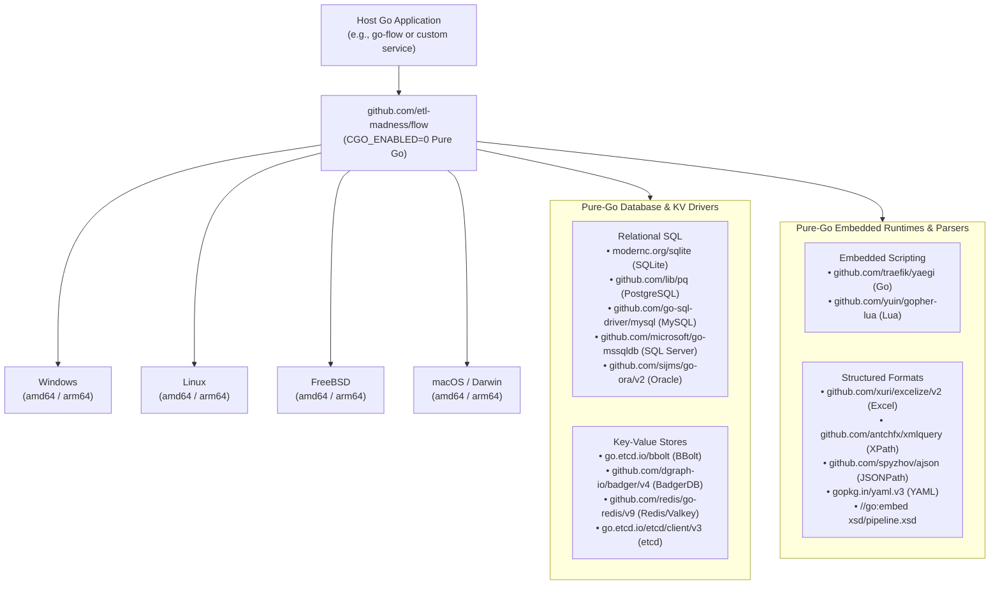
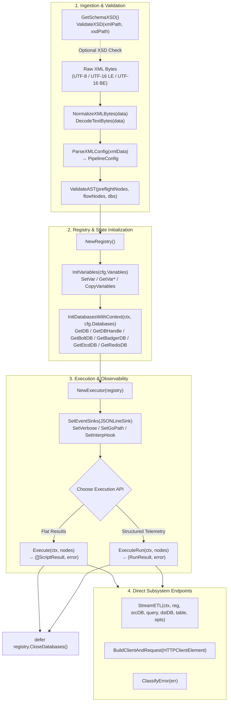
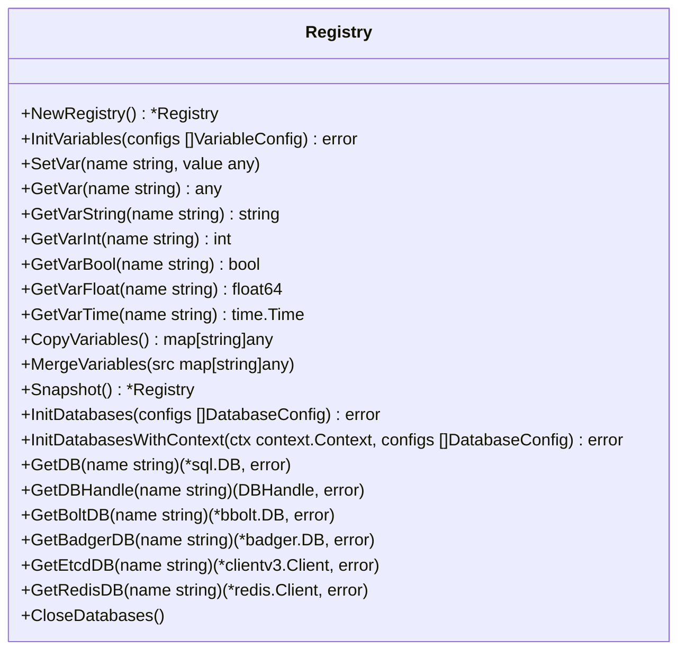
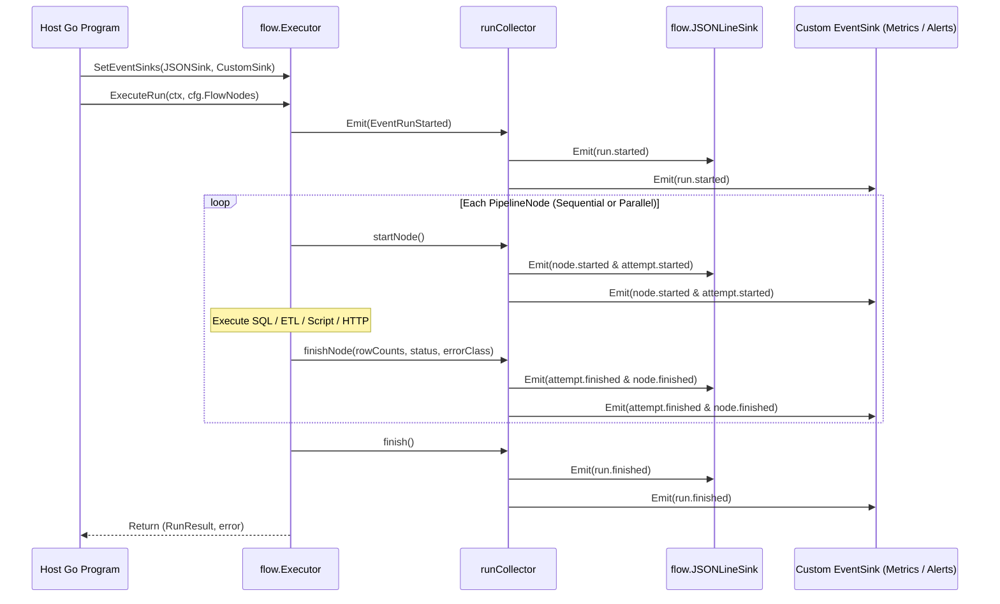

# Flow Go Package Guide: Cross-Platform Compilation & API Endpoints

> **Ecosystem Documentation**: This guide is part of the official **ETL Madness Flow** documentation published at [https://etl-madness.github.io/flow-docs](https://etl-madness.github.io/flow-docs).
>
> - **Core Engine Package (`flow`)**: [github.com/etl-madness/flow](https://github.com/etl-madness/flow)
> - **CLI & Runtime Implementation (`go-flow`)**: [github.com/etl-madness/go-flow](https://github.com/etl-madness/go-flow)

---

## Table of Contents

- [Flow Go Package Guide: Cross-Platform Compilation \& API Endpoints](#flow-go-package-guide-cross-platform-compilation--api-endpoints)
  - [Table of Contents](#table-of-contents)
  - [1. Package Inclusion \& Cross-Platform Compilation](#1-package-inclusion--cross-platform-compilation)
    - [Including `flow` in Your Go Project](#including-flow-in-your-go-project)
    - [Pure-Go Architecture (`CGO_ENABLED=0`)](#pure-go-architecture-cgo_enabled0)
    - [Target OS \& Architecture Matrix](#target-os--architecture-matrix)
    - [Recommended Compiler Flags](#recommended-compiler-flags)
    - [Platform-Specific Compile Instructions](#platform-specific-compile-instructions)
      - [1. Windows (`windows/amd64` and `windows/arm64`)](#1-windows-windowsamd64-and-windowsarm64)
      - [2. Linux (`linux/amd64` and `linux/arm64`)](#2-linux-linuxamd64-and-linuxarm64)
      - [3. FreeBSD (`freebsd/amd64` and `freebsd/arm64`)](#3-freebsd-freebsdamd64-and-freebsdarm64)
      - [4. macOS (`darwin/amd64`, `darwin/arm64`, and Universal Binary)](#4-macos-darwinamd64-darwinarm64-and-universal-binary)
    - [OS Runtime Considerations](#os-runtime-considerations)
  - [2. Overview of Package Endpoints (Public API Reference)](#2-overview-of-package-endpoints-public-api-reference)
    - [End-to-End Package Lifecycle](#end-to-end-package-lifecycle)
    - [2.1 Configuration \& XML Parsing (`config.go`)](#21-configuration--xml-parsing-configgo)
    - [2.2 Embedded XSD Schema (`schema.go`)](#22-embedded-xsd-schema-schemago)
    - [2.3 UTF-8 \& UTF-16 Encoding Utilities (`encoding.go`)](#23-utf-8--utf-16-encoding-utilities-encodinggo)
    - [2.4 AST Semantic Validation (`validator.go`)](#24-ast-semantic-validation-validatorgo)
    - [2.5 State, Variable \& Database Registry (`registry.go`)](#25-state-variable--database-registry-registrygo)
    - [2.6 Pipeline Execution Engine (`executor.go`)](#26-pipeline-execution-engine-executorgo)
    - [2.7 High-Throughput Streaming ETL (`etl.go`)](#27-high-throughput-streaming-etl-etlgo)
    - [2.8 HTTP Client Builder (`http_client.go`)](#28-http-client-builder-http_clientgo)
    - [2.9 Observability, Events \& Error Classification (`observability.go`)](#29-observability-events--error-classification-observabilitygo)
    - [2.10 Custom Observability \& Telemetry Examples](#210-custom-observability--telemetry-examples)
      - [Complete Program: Multi-Sink Real-Time Telemetry + Post-Run Inspection](#complete-program-multi-sink-real-time-telemetry--post-run-inspection)

---

## 1. Package Inclusion & Cross-Platform Compilation

### Including `flow` in Your Go Project

`github.com/etl-madness/flow` is designed as a zero-global-state, embeddable library. Add it to your Go module using `go get`:

```bash
go get github.com/etl-madness/flow@latest
```

In your `go.mod`:

```go
module my-organization/data-runner

go 1.26

require (
    github.com/etl-madness/flow v1.3.4
)
```

Minimal embedding example (`cmd/runner/main.go`):

```go
package main

import (
	"context"
	"fmt"
	"log"
	"os"

	"github.com/etl-madness/flow"
)

func main() {
	rawXML, err := os.ReadFile("pipeline.xml")
	if err != nil {
		log.Fatalf("failed to read XML: %v", err)
	}

	cfg, err := flow.ParseXMLConfig(rawXML)
	if err != nil {
		log.Fatalf("failed to parse XML: %v", err)
	}

	if err := flow.ValidateAST(cfg.PreflightNodes, cfg.FlowNodes, cfg.Databases); err != nil {
		log.Fatalf("AST validation failed: %v", err)
	}

	reg := flow.NewRegistry()
	if err := reg.InitVariables(cfg.Variables); err != nil {
		log.Fatalf("variable init failed: %v", err)
	}
	if err := reg.InitDatabases(cfg.Databases); err != nil {
		log.Fatalf("database init failed: %v", err)
	}
	defer reg.CloseDatabases()

	exec := flow.NewExecutor(reg)
	exec.SetEventSink(&flow.JSONLineSink{Writer: os.Stdout})

	if len(cfg.PreflightNodes) > 0 {
		if _, err := exec.ExecuteRun(context.Background(), cfg.PreflightNodes); err != nil {
			log.Fatalf("preflight failed: %v", err)
		}
	}

	run, err := exec.ExecuteRun(context.Background(), cfg.FlowNodes)
	if err != nil {
		log.Fatalf("pipeline run %s failed (%s): %v", run.RunID, run.ErrorClass, err)
	}
	fmt.Printf("Run %s succeeded in %s\n", run.RunID, run.FinishedAt.Sub(run.StartedAt))
}
```

---

### Pure-Go Architecture (`CGO_ENABLED=0`)

Every database driver, key-value engine, and embedded script runtime inside `flow` is implemented in **100% pure Go**. No C compiler (`gcc`, `clang`, `mingw`) or C headers are required when cross-compiling across operating systems:



---

### Target OS & Architecture Matrix

| Target OS | `GOOS` | `GOARCH` | `CGO_ENABLED` | Output Binary Example | Notes |
| :--- | :--- | :--- | :--- | :--- | :--- |
| **Windows (x64)** | `windows` | `amd64` | `0` | `flow-runner-windows-amd64.exe` | Standard Windows Server & Desktop (Intel/AMD) |
| **Windows (ARM64)** | `windows` | `arm64` | `0` | `flow-runner-windows-arm64.exe` | Windows on ARM / Surface / ARM64 VMs |
| **Linux (x64)** | `linux` | `amd64` | `0` | `flow-runner-linux-amd64` | Static binary; runs on glibc and musl distributions |
| **Linux (ARM64)** | `linux` | `arm64` | `0` | `flow-runner-linux-arm64` | AWS Graviton, Ampere, Raspberry Pi, Apple Silicon Linux VMs |
| **FreeBSD (x64)** | `freebsd` | `amd64` | `0` | `flow-runner-freebsd-amd64` | FreeBSD 13/14+ jails and servers (x86_64) |
| **FreeBSD (ARM64)** | `freebsd` | `arm64` | `0` | `flow-runner-freebsd-arm64` | FreeBSD on AArch64 hardware & cloud instances |
| **macOS (Intel)** | `darwin` | `amd64` | `0` | `flow-runner-darwin-amd64` | Intel-based Mac hardware |
| **macOS (Apple Silicon)** | `darwin` | `arm64` | `0` | `flow-runner-darwin-arm64` | M1 / M2 / M3 / M4 Apple Silicon Macs |

### Recommended Compiler Flags

When building production binaries that embed `github.com/etl-madness/flow`, pass the following flags to `go build`:

- `CGO_ENABLED=0`: Guarantees a statically linked pure-Go binary without dynamic `libc` dependencies.
- `-trimpath`: Removes local filesystem paths from stack traces for reproducible builds.
- `-ldflags="-s -w"`: Strips DWARF symbol tables and debug info, reducing binary size by ~25-30%.
- `-ldflags="-s -w -X main.version=v1.2.32"`: Injects build-time version metadata.

---

### Platform-Specific Compile Instructions

#### 1. Windows (`windows/amd64` and `windows/arm64`)

**From PowerShell (Windows Host):**

```powershell
# Windows x64 (amd64)
$env:CGO_ENABLED = "0"
$env:GOOS = "windows"
$env:GOARCH = "amd64"
go build -trimpath -ldflags="-s -w" -o dist/flow-runner-windows-amd64.exe ./cmd/runner

# Windows ARM64
$env:GOOS = "windows"
$env:GOARCH = "arm64"
go build -trimpath -ldflags="-s -w" -o dist/flow-runner-windows-arm64.exe ./cmd/runner
```

**From Bash (Linux / macOS / FreeBSD Host):**

```bash
CGO_ENABLED=0 GOOS=windows GOARCH=amd64 \
  go build -trimpath -ldflags="-s -w" -o dist/flow-runner-windows-amd64.exe ./cmd/runner

CGO_ENABLED=0 GOOS=windows GOARCH=arm64 \
  go build -trimpath -ldflags="-s -w" -o dist/flow-runner-windows-arm64.exe ./cmd/runner
```

#### 2. Linux (`linux/amd64` and `linux/arm64`)

**From Bash:**

```bash
# Linux x86_64
CGO_ENABLED=0 GOOS=linux GOARCH=amd64 \
  go build -trimpath -ldflags="-s -w -extldflags '-static'" -o dist/flow-runner-linux-amd64 ./cmd/runner

# Linux ARM64 (AWS Graviton / AArch64)
CGO_ENABLED=0 GOOS=linux GOARCH=arm64 \
  go build -trimpath -ldflags="-s -w -extldflags '-static'" -o dist/flow-runner-linux-arm64 ./cmd/runner
```

**From PowerShell:**

```powershell
$env:CGO_ENABLED = "0"
$env:GOOS = "linux"
$env:GOARCH = "amd64"
go build -trimpath -ldflags="-s -w" -o dist/flow-runner-linux-amd64 ./cmd/runner

$env:GOARCH = "arm64"
go build -trimpath -ldflags="-s -w" -o dist/flow-runner-linux-arm64 ./cmd/runner
```

#### 3. FreeBSD (`freebsd/amd64` and `freebsd/arm64`)

**From Bash:**

```bash
# FreeBSD x86_64
CGO_ENABLED=0 GOOS=freebsd GOARCH=amd64 \
  go build -trimpath -ldflags="-s -w" -o dist/flow-runner-freebsd-amd64 ./cmd/runner

# FreeBSD ARM64
CGO_ENABLED=0 GOOS=freebsd GOARCH=arm64 \
  go build -trimpath -ldflags="-s -w" -o dist/flow-runner-freebsd-arm64 ./cmd/runner
```

**From PowerShell:**

```powershell
$env:CGO_ENABLED = "0"
$env:GOOS = "freebsd"
$env:GOARCH = "amd64"
go build -trimpath -ldflags="-s -w" -o dist/flow-runner-freebsd-amd64 ./cmd/runner

$env:GOARCH = "arm64"
go build -trimpath -ldflags="-s -w" -o dist/flow-runner-freebsd-arm64 ./cmd/runner
```

#### 4. macOS (`darwin/amd64`, `darwin/arm64`, and Universal Binary)

**From Bash:**

```bash
# macOS Intel (x86_64)
CGO_ENABLED=0 GOOS=darwin GOARCH=amd64 \
  go build -trimpath -ldflags="-s -w" -o dist/flow-runner-darwin-amd64 ./cmd/runner

# macOS Apple Silicon (M1/M2/M3/M4 arm64)
CGO_ENABLED=0 GOOS=darwin GOARCH=arm64 \
  go build -trimpath -ldflags="-s -w" -o dist/flow-runner-darwin-arm64 ./cmd/runner

# Optional (on macOS host): Combine into a single Universal macOS binary using lipo
lipo -create -output dist/flow-runner-darwin-universal \
  dist/flow-runner-darwin-amd64 \
  dist/flow-runner-darwin-arm64
```

**From PowerShell:**

```powershell
$env:CGO_ENABLED = "0"
$env:GOOS = "darwin"
$env:GOARCH = "amd64"
go build -trimpath -ldflags="-s -w" -o dist/flow-runner-darwin-amd64 ./cmd/runner

$env:GOARCH = "arm64"
go build -trimpath -ldflags="-s -w" -o dist/flow-runner-darwin-arm64 ./cmd/runner
```

---

### OS Runtime Considerations

1. **Embedded XSD Schema**: `xsd/pipeline.xsd` is compiled directly into the binary via Go's `//go:embed` directive in `schema.go` and exposed through `flow.GetSchemaXSD()`. You do **not** need to ship the `xsd/` folder alongside your compiled binary unless calling `flow.ValidateXSD(xmlPath, xsdPath)` against an explicit file on disk.
2. **Default `<script language="shell">` Resolution**:
   - When `SHELL` is set in the environment, `flow` executes `$SHELL -c "..."`.
   - Otherwise, `flow` automatically selects the native OS shell based on `runtime.GOOS`:
     - `windows`: `cmd /C`
     - `darwin` (macOS): `zsh -c`
     - `freebsd`: `sh -c`
     - `linux` / other Unix: `sh -c`
3. **Embedded Scripting (`go` and `lua`)**:
   - `<script language="go">` (Yaegi) and `<script language="lua">` (Gopher-Lua) execute **in-memory** inside the Go process with zero external binary dependencies across Windows, Linux, FreeBSD, and macOS.
4. **External Tooling (Optional)**:
   - `flow.ValidateXSD` requires `xmllint` (`libxml2-utils` on Debian/Ubuntu, `libxml2` on FreeBSD/macOS/Windows) in `PATH`.
   - `<script language="dotnet-script">` / `csx` requires the .NET SDK and `dotnet-script` global tool in `PATH`.

---

## 2. Overview of Package Endpoints (Public API Reference)

### End-to-End Package Lifecycle

The diagram below illustrates how every exported endpoint in `github.com/etl-madness/flow` interacts during a pipeline run:



---

### 2.1 Configuration & XML Parsing (`config.go`)

| Endpoint / Symbol | Signature | Description |
| :--- | :--- | :--- |
| **`ParseXMLConfig`** | `func ParseXMLConfig(xmlData []byte) (PipelineConfig, error)` | Normalizes UTF-8/UTF-16 XML bytes and decodes `<variables>`, `<databases>`, `<preflight>`, and `<flow>` (or `<scripts>`) into a structured `PipelineConfig` AST. |
| **`ValidateXSD`** | `func ValidateXSD(xmlPath string, xsdPath string) error` | Normalizes the target XML file and invokes `xmllint --schema` against `xsdPath`, returning detailed schema validation diagnostics on failure. |
| **`PipelineConfig`** | `struct { Variables []VariableConfig; Databases []DatabaseConfig; PreflightNodes []PipelineNode; FlowNodes []PipelineNode }` | Top-level container returned by `ParseXMLConfig`. |
| **`VariableConfig`** | `struct { Name, Type, Value string }` | Declarative variable definition (`string`, `int`, `bool`, `float`, `datetime`, `Object`). |
| **`DatabaseConfig`** | `struct { Name, Driver, ConnectionString string; MaxOpenConns, MaxIdleConns int; ConnMaxLifetime time.Duration; Workload string }` | Database or KV connection definition (`postgres`, `mysql`, `sqlite`, `sqlserver`, `oracle`, `bbolt`, `badger`, `redis`, `etcd`) with optional workload tuning (`oltp`, `bulk`, `analytics`). |
| **`PipelineNode`** | `struct { Kind NodeKind; ... }` | Polymorphic AST node representing a control-flow container (`<group>`, `<if>`, `<foreach>`, `<while>`, `<parallel>`) or leaf task (`<script>`, `<sql>`, `<sql_bulk>`, `<kv>`, `<kv_bulk>`, `<http_client>`, `<assert>`, `<template>`, `<html_template>`, `<file_read>`, `<file_save>`, `<excel_read>`, `<excel_write>`, `<xml_xpath>`, `<json_path>`, `<yaml_path>`). |
| **`NodeKind`** | `type NodeKind int` | Enum identifying the AST node type (`NodeScript`, `NodeGroup`, `NodeIf`, `NodeForEach`, `NodeParallel`, `NodeWhile`, `NodeHTTPClient`, `NodeTemplate`, `NodeHtmlTemplate`, `NodeFileSave`, `NodeFileRead`, `NodeExcelRead`, `NodeExcelWrite`, `NodeXMLXPath`, `NodeJSONPath`, `NodeYAMLPath`, `NodeSQL`, `NodeSQLBulk`, `NodeAssert`, `NodeKV`, `NodeKVBulk`). |
| **Element Helpers** | `FileSaveElement.GetFilePath()`, `FileSaveElement.GetInputVar()`, `FileReadElement.GetFilePath()`, `FileReadElement.GetOutputVar()`, `TemplateElement.GetOutputVar()`, `HtmlTemplateElement.GetOutputVar()`, `ExcelReadElement.GetOutputVar()`, `XmlXPathElement.GetXPath()`, `XmlXPathElement.GetOutputVar()`, `JsonPathElement.GetJSONPath()`, `JsonPathElement.GetOutputVar()`, `YamlPathElement.GetYAMLPath()`, `YamlPathElement.GetOutputVar()`, `KVElement.GetOutputVar()`, `KVBulkElement.GetOutputVar()` | Resolve canonical attribute values across supported XML attribute aliases (e.g., `output_var` vs `out_var` vs `var`, `file` vs `path` vs `filename`). |

---

### 2.2 Embedded XSD Schema (`schema.go`)

| Endpoint | Signature | Description |
| :--- | :--- | :--- |
| **`GetSchemaXSD`** | `func GetSchemaXSD() []byte` | Returns the compiled-in `xsd/pipeline.xsd` bytes embedded via `//go:embed`. Useful for serving the schema over HTTP, writing a temporary XSD file for `ValidateXSD`, or IDE tooling integration. |

---

### 2.3 UTF-8 & UTF-16 Encoding Utilities (`encoding.go`)

| Endpoint | Signature | Description |
| :--- | :--- | :--- |
| **`NormalizeXMLBytes`** | `func NormalizeXMLBytes(data []byte) []byte` | Detects UTF-8 BOM, UTF-16 LE/BE BOMs, or BOM-less UTF-16 XML byte streams, transcodes them to valid UTF-8, and rewrites `encoding="UTF-16"` XML declarations to `encoding="UTF-8"`. |
| **`DecodeTextBytes`** | `func DecodeTextBytes(data []byte) string` | Decodes raw file bytes (from `<file_read>`, `<template>`, or `<script file_path="...">`) into a clean UTF-8 `string`, automatically handling UTF-8 BOM and UTF-16 LE/BE encodings. |

---

### 2.4 AST Semantic Validation (`validator.go`)

| Endpoint | Signature | Description |
| :--- | :--- | :--- |
| **`ValidateAST`** | `func ValidateAST(preflightNodes []PipelineNode, flowNodes []PipelineNode, registeredDBs []DatabaseConfig) error` | Performs static semantic verification across both `<preflight>` and `<flow>` AST trees before execution: checks for duplicate node IDs, verifies that all referenced `db` / `target_db` connections exist in `registeredDBs`, validates loop bounds (`max_iterations`, `max_threads`), and ensures required attributes/bodies (`file_path`, `var`, inline code, `target_table`, `uri`/`url`, XPath/JSONPath/YAMLPath expressions) are present. |

---

### 2.5 State, Variable & Database Registry (`registry.go`)

`Registry` is an isolated, thread-safe state container holding pipeline variables and active database/KV connection handles. Multiple `Registry` instances can run concurrently in the same process without shared global state.



| Endpoint | Signature | Description |
| :--- | :--- | :--- |
| **`NewRegistry`** | `func NewRegistry() *Registry` | Instantiates an empty, thread-safe `Registry`. |
| **`InitVariables`** | `func (r *Registry) InitVariables(configs []VariableConfig) error` | Parses and registers initial variables by type (`int`, `bool`, `float`, `datetime`, `Object`, `string`). |
| **`SetVar` / `GetVar`** | `func (r *Registry) SetVar(name string, value interface{})`<br>`func (r *Registry) GetVar(name string) interface{}` | Thread-safe getter and setter for arbitrary runtime values; tracks mutated keys in `dirtyVars` for parallel branch merging. |
| **Typed Variable Getters** | `GetVarString(name) string`<br>`GetVarInt(name) int`<br>`GetVarBool(name) bool`<br>`GetVarFloat(name) float64`<br>`GetVarTime(name) time.Time` | Retrieve variables coerced to target Go types (automatically parsing strings or converting across numeric types). Exposed to Yaegi Go scripts (`host/vars`) and Gopher-Lua scripts (`vars.*`). |
| **`CopyVariables` / `MergeVariables`** | `func (r *Registry) CopyVariables() map[string]interface{}`<br>`func (r *Registry) MergeVariables(src map[string]interface{})` | Creates a defensive shallow copy of all variables or merges a map of variables back into the registry. |
| **`Snapshot`** | `func (r *Registry) Snapshot() *Registry` | Clones variable state into an isolated child `Registry` while sharing underlying database connection pools (used by `<parallel>` worker goroutines). |
| **`InitDatabases` / `InitDatabasesWithContext`** | `func (r *Registry) InitDatabases(configs []DatabaseConfig) error`<br>`func (r *Registry) InitDatabasesWithContext(ctx context.Context, configs []DatabaseConfig) error` | Interpolates `{{Variable}}` placeholders in connection strings, opens SQL pools and KV stores (`bbolt`, `badger`, `etcd`, `redis`), applies connection pool tuning, and atomically rolls back/closes any opened handles if initialization fails partway through. |
| **Database & KV Handle Getters** | `GetDB(name) (*sql.DB, error)`<br>`GetDBHandle(name) (DBHandle, error)`<br>`GetBoltDB(name) (*bbolt.DB, error)`<br>`GetBadgerDB(name) (*badger.DB, error)`<br>`GetEtcdDB(name) (*clientv3.Client, error)`<br>`GetRedisDB(name) (*redis.Client, error)` | Retrieve active SQL `*sql.DB` pools (or `DBHandle` with driver name) and specialized Key-Value store clients by logical name. |
| **`CloseDatabases`** | `func (r *Registry) CloseDatabases()` | Cleanly closes and evicts all SQL pools, BBolt files, BadgerDB directories, etcd clients, and Redis clients tracked by the registry. |

---

### 2.6 Pipeline Execution Engine (`executor.go`)

| Endpoint | Signature | Description |
| :--- | :--- | :--- |
| **`NewExecutor`** | `func NewExecutor(r *Registry) *Executor` | Creates a new pipeline `Executor` bound to the given `Registry`. |
| **`Execute`** | `func (e *Executor) Execute(ctx context.Context, nodes []PipelineNode) ([]ScriptResult, error)` | Executes a slice of `PipelineNode`s and returns a flat `[]ScriptResult` slice (each containing `ScriptID`, `ReturnCode`, `ResultsString`, and `Duration`) along with any execution error. |
| **`ExecuteRun`** | `func (e *Executor) ExecuteRun(ctx context.Context, nodes []PipelineNode) (RunResult, error)` | Executes a slice of `PipelineNode`s and returns a structured `RunResult` containing run-level metadata, hierarchical `NodeResult`s, `RowCounts`, `ErrorClass`, and timing telemetry. |
| **`SetEventSink` / `SetEventSinks` / `AddEventSink`** | `func (e *Executor) SetEventSink(sink EventSink)`<br>`func (e *Executor) SetEventSinks(sinks ...EventSink)`<br>`func (e *Executor) AddEventSink(sink EventSink)` | Configures one or more real-time `EventSink` listeners (such as `JSONLineSink`) to receive lifecycle events (`run.started`, `node.started`, `attempt.started`, `attempt.finished`, `node.finished`, `run.finished`). |
| **`SetVerbose`** | `func (e *Executor) SetVerbose(verbose bool)` | Enables or disables real-time console progress logging during node execution. |
| **`SetGoPath`** | `func (e *Executor) SetGoPath(goPath string)` | Configures `GOPATH` for embedded Yaegi `<script language="go">` evaluations. |
| **`SetInterpreterHook` / `SetInterpHook`** | `func (e *Executor) SetInterpreterHook(hook func(*interp.Options))` | Registers a callback to customize Yaegi `interp.Options` (e.g., injecting custom symbols or environment variables) before Go script evaluation. |
| **`SetOptionsPath`** | `func (e *Executor) SetOptionsPath(path string)` | Records the configuration/options file path on emitted `ExecutionEvent`s and `RunResult.OptionsPath`. |

---

### 2.7 High-Throughput Streaming ETL (`etl.go`)

| Endpoint / Symbol | Signature | Description |
| :--- | :--- | :--- |
| **`StreamETL`** | `func StreamETL(ctx context.Context, r *Registry, srcDBName, queryStr, dstDBName, targetTable string, opts ETLOptions) (int64, error)` | Streams rows from a source SQL query on `srcDBName` directly into `targetTable` on `dstDBName` in chunks of `opts.BatchSize`. Uses native TDS `mssql.CopyIn` bulk copy when targeting SQL Server (`sqlserver`/`mssql`) and automatically translates parameter placeholders (`$1` for Postgres, `?` for MySQL/SQLite, `:1` for Oracle, `@p1` for MSSQL) while enforcing a 2,100-parameter safety ceiling per batch and preserving binary BLOBs. Also exported into Yaegi Go scripts as `db.StreamETL(...)`. |
| **`ETLOptions`** | `struct { BatchSize int; Tablock, CheckConstraints, FireTriggers, KeepNulls bool }` | Configures batch chunk sizes and SQL Server bulk-copy options (`TABLOCK`, constraint checking, trigger firing, and `KEEPNULLS`). |

---

### 2.8 HTTP Client Builder (`http_client.go`)

| Endpoint / Symbol | Signature | Description |
| :--- | :--- | :--- |
| **`BuildClientAndRequest`** | `func BuildClientAndRequest(elem HTTPClientElement) (*http.Client, *http.Request, error)` | Constructs an isolated `*http.Client` (cloning `http.DefaultTransport` so TLS, proxy, keep-alive, buffer, and timeout settings never mutate global state; enforcing a 30s default timeout) and `*http.Request` from an `HTTPClientElement`. |
| **`HTTPClientElement`** | `struct { ID, URI, URL, Method, Data, BodyContent, Headers, ContentType, Timeout, Proxy string; ... }` | Full declarative HTTP client configuration supporting custom TLS versions (`TLS 1.2`, `TLS 1.3`), SNI (`tls_server_name`), redirect policies (`follow_redirects`, `max_redirects`), in-memory cookie jars (`cookie_jar`), and status/body output variable bindings. |

---

### 2.9 Observability, Events & Error Classification (`observability.go`)

| Endpoint / Symbol | Signature | Description |
| :--- | :--- | :--- |
| **`ClassifyError`** | `func ClassifyError(err error) ErrorClass` | Categorizes runtime errors into structured `ErrorClass` values (`canceled`, `configuration`, `validation`, `database`, `http`, `filesystem`, `script`, `template`, `data_format`, `internal`, `unknown`). |
| **`EventSink`** | `type EventSink interface { Emit(context.Context, ExecutionEvent) error }` | Interface implemented by telemetry consumers to receive real-time pipeline and node lifecycle events. |
| **`JSONLineSink`** | `type JSONLineSink struct { Writer io.Writer }` | Thread-safe built-in `EventSink` that serializes each `ExecutionEvent` as a single-line JSON object (JSONL) with automatic redaction of sensitive credentials (`password`, `pwd`, `token`, `secret`, `authorization`). |
| **`RunResult`** | `struct { RunID string; StartedAt, FinishedAt time.Time; Status RunStatus; UserName, Hostname, OptionsPath string; ErrorClass ErrorClass; ErrorMessage string; RowCounts RowCounts; Nodes []NodeResult }` | Complete structured summary of a pipeline execution returned by `Executor.ExecuteRun`. |
| **`NodeResult` & `AttemptResult`** | `struct { ExecutionID, ParentExecutionID, NodeID, NodeKind, NodePath string; Status RunStatus; Attempts []AttemptResult; RowCounts RowCounts; ... }` | Per-node execution trace including hierarchical path (e.g., `group[0]/foreach[1]/sql[0]`), attempt history, and extracted `RowCounts` (`Read`, `Written`, `Affected`). |

---

### 2.10 Custom Observability & Telemetry Examples

`flow` provides two complementary observability mechanisms out of the box:
1. **Real-Time Streaming Events (`EventSink`)**: Implement the single-method `EventSink` interface (`Emit(ctx context.Context, event ExecutionEvent) error`) and attach one or more sinks via `Executor.SetEventSinks(...)` or `Executor.AddEventSink(...)`.
2. **Post-Execution Telemetry Summary (`RunResult`)**: Call `Executor.ExecuteRun(ctx, nodes)` to receive a complete hierarchical summary of every node, attempt, row count (`Read`, `Written`, `Affected`), duration, and classified error (`ErrorClass`).



#### Complete Program: Multi-Sink Real-Time Telemetry + Post-Run Inspection

```go
package main

import (
	"bytes"
	"context"
	"encoding/json"
	"fmt"
	"log"
	"net/http"
	"os"
	"sync"
	"time"

	"github.com/etl-madness/flow"
)

// 1. Custom Metrics & Alerting Sink implementing flow.EventSink
type TelemetrySink struct {
	mu          sync.Mutex
	nodeStarts  map[string]time.Time
	webhookURL  string
	httpClient  *http.Client
}

func NewTelemetrySink(webhookURL string) *TelemetrySink {
	return &TelemetrySink{
		nodeStarts: make(map[string]time.Time),
		webhookURL: webhookURL,
		httpClient: &http.Client{Timeout: 5 * time.Second},
	}
}

// Emit is called synchronously for every lifecycle event across all goroutines.
func (s *TelemetrySink) Emit(ctx context.Context, ev flow.ExecutionEvent) error {
	s.mu.Lock()
	defer s.mu.Unlock()

	switch ev.Type {
	case flow.EventRunStarted:
		log.Printf("[TELEMETRY] Run %s started by %s@%s", ev.RunID, ev.UserName, ev.Hostname)

	case flow.EventNodeStarted:
		s.nodeStarts[ev.ExecutionID] = ev.OccurredAt
		log.Printf("[TELEMETRY] -> Node start: path=%s id=%q kind=%s",
			ev.NodePath, ev.NodeID, ev.NodeKind)

	case flow.EventNodeFinished:
		var duration time.Duration
		if start, ok := s.nodeStarts[ev.ExecutionID]; ok {
			duration = ev.OccurredAt.Sub(start)
			delete(s.nodeStarts, ev.ExecutionID)
		}
		log.Printf("[TELEMETRY] <- Node done:  path=%s id=%q status=%s duration=%s rows(R:%d W:%d A:%d)",
			ev.NodePath, ev.NodeID, ev.Status, duration.Round(time.Millisecond),
			ev.RowCounts.Read, ev.RowCounts.Written, ev.RowCounts.Affected)

		// Trigger an immediate alert if a node fails
		if ev.Status == flow.RunStatusFailed && s.webhookURL != "" {
			go s.sendFailureAlert(ev)
		}

	case flow.EventRunFinished:
		log.Printf("[TELEMETRY] Run %s finished with status=%s totalRows(R:%d W:%d A:%d)",
			ev.RunID, ev.Status,
			ev.RowCounts.Read, ev.RowCounts.Written, ev.RowCounts.Affected)
	}
	return nil
}

func (s *TelemetrySink) sendFailureAlert(ev flow.ExecutionEvent) {
	payload, _ := json.Marshal(map[string]any{
		"run_id":        ev.RunID,
		"node_id":       ev.NodeID,
		"node_kind":     ev.NodeKind,
		"node_path":     ev.NodePath,
		"error_class":   ev.ErrorClass,
		"error_message": ev.ErrorMessage,
		"hostname":      ev.Hostname,
	})
	resp, err := s.httpClient.Post(s.webhookURL, "application/json", bytes.NewReader(payload))
	if err == nil {
		_ = resp.Body.Close()
	}
}

func main() {
	ctx := context.Background()

	// Load and validate pipeline XML
	xmlBytes, err := os.ReadFile("pipeline.xml")
	if err != nil {
		log.Fatalf("failed to read XML: %v", err)
	}
	cfg, err := flow.ParseXMLConfig(xmlBytes)
	if err != nil {
		log.Fatalf("failed to parse XML: %v", err)
	}
	if err := flow.ValidateAST(cfg.PreflightNodes, cfg.FlowNodes, cfg.Databases); err != nil {
		log.Fatalf("AST validation error: %v", err)
	}

	// Initialize isolated Registry
	reg := flow.NewRegistry()
	defer reg.CloseDatabases()

	if err := reg.InitVariables(cfg.Variables); err != nil {
		log.Fatalf("variable init failed: %v", err)
	}
	if err := reg.InitDatabasesWithContext(ctx, cfg.Databases); err != nil {
		log.Fatalf("database init failed: %v", err)
	}

	// Open a JSONL audit log file for the built-in JSONLineSink
	auditFile, err := os.OpenFile("pipeline_events.jsonl", os.O_CREATE|os.O_WRONLY|os.O_APPEND, 0644)
	if err != nil {
		log.Fatalf("failed to open audit file: %v", err)
	}
	defer auditFile.Close()

	// Configure the Executor with both the built-in JSONLineSink and our custom TelemetrySink
	exec := flow.NewExecutor(reg)
	exec.SetOptionsPath("pipeline.xml")
	exec.SetEventSinks(
		&flow.JSONLineSink{Writer: auditFile},
		NewTelemetrySink(os.Getenv("ALERT_WEBHOOK_URL")),
	)

	// Execute preflight nodes (if any)
	if len(cfg.PreflightNodes) > 0 {
		if _, err := exec.ExecuteRun(ctx, cfg.PreflightNodes); err != nil {
			log.Fatalf("preflight failed: %v", err)
		}
	}

	// Execute main flow and capture the structured RunResult
	runResult, execErr := exec.ExecuteRun(ctx, cfg.FlowNodes)

	// Inspect the post-run RunResult summary
	fmt.Printf("\n=== Pipeline Run Summary (%s) ===\n", runResult.RunID)
	fmt.Printf("Status:   %s\n", runResult.Status)
	fmt.Printf("Duration: %s\n", runResult.FinishedAt.Sub(runResult.StartedAt).Round(time.Millisecond))
	fmt.Printf("Rows:     Read=%d, Written=%d, Affected=%d\n",
		runResult.RowCounts.Read, runResult.RowCounts.Written, runResult.RowCounts.Affected)

	for _, node := range runResult.Nodes {
		dur := node.FinishedAt.Sub(node.StartedAt).Round(time.Millisecond)
		fmt.Printf("  - [%s] %-22s (kind=%-10s id=%-15s) %8s | attempts=%d\n",
			node.Status, node.NodePath, node.NodeKind, node.NodeID, dur, len(node.Attempts))
		if node.Status == flow.RunStatusFailed {
			fmt.Printf("      ErrorClass: %s | Message: %s\n", node.ErrorClass, node.ErrorMessage)
		}
	}

	if execErr != nil {
		os.Exit(1)
	}
}
```
